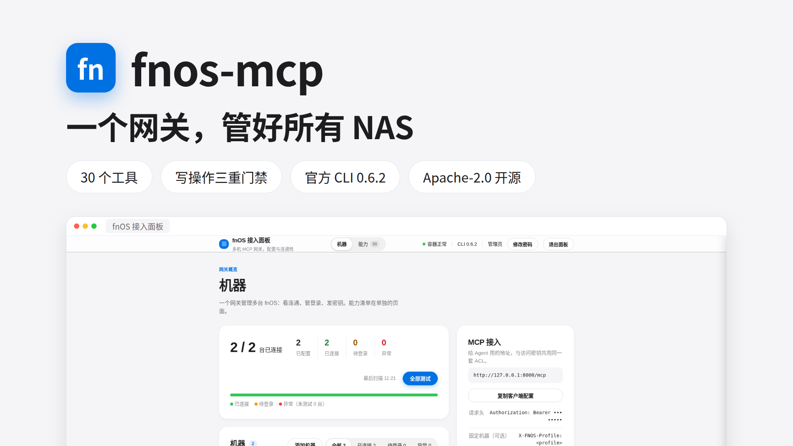

# fnos-mcp-gateway

**一个网址，让 AI 直接操作你的 fnOS NAS —— 本地什么都不用装。**



把这个网关部署在内网里，AI 客户端（Claude、ChatGPT、各类 Agent）填上网关地址和一把密钥，就能通过 MCP 操作你的多台 fnOS NAS：看存储、管文件、管 Docker。NAS 的地址和账号凭据只留在网关里，AI 永远接触不到。

## 快速开始

需要一台能跑 Docker 的机器（就部署在 NAS 上也可以）：

```bash
git clone https://github.com/izerok/fnos-mcp-gateway.git
cd fnos-mcp-gateway
cp config/profiles.example.json config/profiles.json   # 改成你的 NAS 机器清单
cp config/tokens.example.json config/tokens.json       # 密钥之后在面板里创建
head -c 32 /dev/urandom > config/panel-session.key
docker compose pull && docker compose up -d
```

打开 `http://127.0.0.1:8000/login`，首次访问设置管理员密码。之后在面板里：添加机器 → 走官方授权流程登录 NAS → 创建访问密钥。

镜像双架构（amd64 / arm64），两个仓库任选：

- `ghcr.io/izerok/fnos-mcp-gateway:v0.1.0`
- `docker.io/izerok/fnos-mcp-gateway:v0.1.0`

容器默认只绑本机回环。对局域网开放时请在前面加反向代理并启用 TLS；本服务的定位是内网 / VPN 环境，不要直接暴露到公网。部署细节见 `docs/deploy.md`。

## 接入 AI 客户端

任何支持 Streamable HTTP 的 MCP 客户端，填两项即可：

- 地址：`http://<网关地址>:8000/mcp`
- 请求头：`Authorization: Bearer <面板里创建的密钥>`

## 核心特性

- **多机管理**：一个网关管多台 fnOS。机器清单只在服务端配置，调用方只能按机器名引用，传不进任意地址。
- **30 个 MCP 工具**（16 读 + 14 写）：系统、存储、文件、监控、Docker 与 Compose 全生命周期，清单见 `docs/tools.md`。
- **Web 面板**：连通状态、四层诊断（网络 / TLS / 认证 / 配置）、机器增删改、密钥管理、连接拓扑、能力清单；限速等参数可在设置页运行时调整，不用改文件重启。
- **写操作三重门禁**：密钥是 admin 或带 `manage_deploy` 能力、目标机器开启 `allow_dangerous`（默认关闭）、请求带 `confirm: true`，三者齐了才执行；全程审计，审计只存参数摘要不存原文。
- **官方登录流程**：走 fnOS 官方两步授权（浏览器确认 + 一次性 code），网关不保存 NAS 账号密码。
- **底座钉版**：所有对 NAS 的操作由官方 fnos-cli 0.6.2 在容器内代为执行，构建时按 SHA-256 校验，运行时绝不下载。

## 视频

- [30 秒介绍（中文）](docs/media/fnos-mcp-30s-cn.mp4) · [English](docs/media/fnos-mcp-30s-en.mp4)

## 安全要点

- 目标地址只来自服务端配置；每个密钥带角色、能力与机器 ACL，ACL 之外返回与不存在相同的 404，不泄露信息。
- 调用限速：读 120 次/分、写 20 次/分（每密钥，可在设置页调整）。
- 审计日志追加式 JSONL（字段白名单、0600 权限），不记录密钥与写操作参数原文。
- 容器单副本单 worker、UID 10001、只读根文件系统运行。
- 已知例外：`fnos_docker_request` 是受同一写门禁约束的兜底工具，可调用 `appcgi.dockermgr.*` 端点，使用前请确认目标机器开启 `allow_dangerous` 的含义。

## 文档

- `docs/deploy.md`：部署、持久化、面板的机器与密钥管理
- `docs/tools.md`：30 个 MCP 工具清单与写门禁
- `docs/compose.md`：Compose 工具背后的 fnOS 端点与语义
- `docs/configuration.md`：配置文件、环境变量与设置页
- `docs/cli-upgrade.md`：官方 CLI 升级 playbook（升级前必读）
- `docs/frontend.md`：面板前端结构与视觉 token

## 本地开发

```bash
python3 -m venv .venv && . .venv/bin/activate
pip install -e ".[dev]"
FNOS_FAKE_STATE_FILE=/tmp/fnos-fake-state.json pytest -q   # 215 个测试，全用假 CLI，不联网不碰真机
python tests/smoke_m1.py && python tests/smoke_m2.py
```

## 许可证

Apache License 2.0，见 `LICENSE`。
